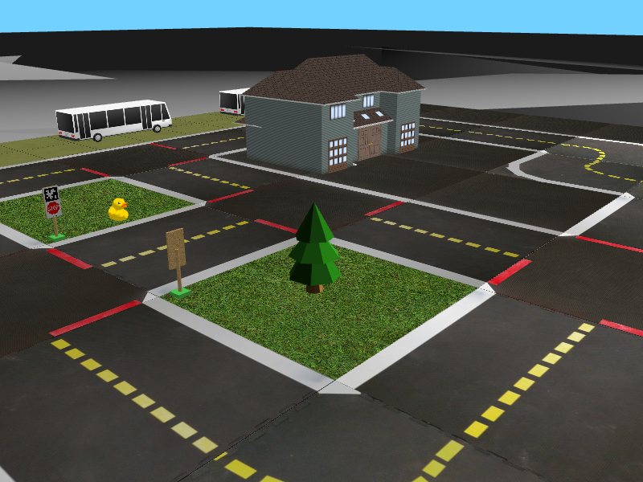

# Duckietown Autonomous Driving:

Bachelor's thesis (team project).

We designed and tuned PID controllers that keep a Duckiebot driving in its lane in the
[Duckietown](https://www.duckietown.org/) simulator. The simulator is Duckietown's open-source
[gym-duckietown](https://github.com/duckietown/gym-duckietown) (`daffy` branch); our work is the
controller code built on top of it.



## Where our code is

| File | Description |
| --- | --- |
| [`our_codes/controllers.py`](gym-duckietown-daffy/our_codes/controllers.py) | The three PID controllers (earlier rule-based "step controller" attempts are kept as comments) |
| [`our_codes/main.py`](gym-duckietown-daffy/our_codes/main.py) | Runs the simulator with the selected controller, logs the lane error, and brute-force searches the PID gains |
| [`manual_control.py`](gym-duckietown-daffy/manual_control.py) | Earlier version with the controller written inline (based on Duckietown's manual control script) |
| `errorvalues*.txt` | Logged lateral lane error, one value per simulation step (30 Hz) |
| [`errorduckie.m`](gym-duckietown-daffy/errorduckie.m) | MATLAB script plotting the hand-tuned vs. brute-force-tuned lane error |

All paths are inside `gym-duckietown-daffy/`. Everything else in that folder is the Duckietown simulator.

## How it works

At every simulation step the controller reads two errors from the simulator:

- `dist`: lateral distance from the lane center
- `angl`: heading angle relative to the lane direction (degrees)

and outputs a `[forward speed, steering]` command. The lane position comes from the simulator's
ground truth (`env.get_lane_pos2`), not from camera images.

Three controller variants were implemented:

- **`PID_3params`**: three proportional gains (speed from distance, steering from distance, steering
  from heading), with the I and D terms scaled by shared time constants `Ti` and `Td`. The robot
  slows down the further it is from the lane center.
- **`PID_9params`**: separate P, I and D gains for each of the three terms.
- **`PID_weighted`**: one combined error `e = 0.7·dist + 0.3·angl`, PID on `e` for steering, constant
  forward speed.

The integral terms are clipped to prevent wind-up.

**Gain tuning:** a brute-force search runs the robot from a fixed start pose on the `small_loop` map
for each gain combination and times the run. As recorded in `errorduckie.m`, tuning `Ti`/`Td` from
1000/10 (hand-tuned) to 3000/15 reduced the run time from **14.75 s to 13.89 s**.

## Running it

The code was written and run in 2022 with Python 3.8 (gym 0.22, pyglet 1.5, numpy 1.22) and has not
been re-tested since.

```bash
cd gym-duckietown-daffy
python3.8 -m venv venv && source venv/bin/activate
pip install -e .
cd our_codes
python main.py
```

Select the controller by changing `controller_name` in `main.py`. The script starts the gain search
and appends the lane error to `errorvalues_tot.txt`.

## Credits

- Duckietown simulator: [duckietown/gym-duckietown](https://github.com/duckietown/gym-duckietown),
  see its license in [`gym-duckietown-daffy/LICENSE.pdf`](gym-duckietown-daffy/LICENSE.pdf).
- Controller design, tuning and experiments: our bachelor's thesis team.
